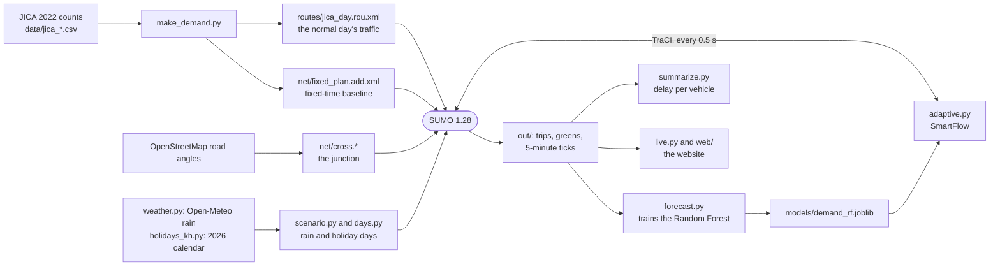

# How SmartFlow works

A one-page map of this repository for judges and reviewers: how the algorithm decides, what every file does, and where each result comes from. The [README](README.md) is the full step-by-step log, with every command and its output.

## In one minute

- **The junction:** IS-03, Monivong Blvd × Charles de Gaulle Blvd (St. 217), Phnom Penh (11.5674° N, 104.9189° E). JICA counted its traffic in 2022.
- **The problem:** a fixed-time plan gives each road the same green every cycle, however long its queue is.
- **SmartFlow:** keeps the signal's order and safety intervals, but ends each green as soon as the vehicles that were waiting have crossed (10 to 50 s). Every 5 minutes, a Random Forest forecasts each road's arrivals for the next 15 minutes, and the busiest roads may then keep their green longer.
- **The test:** the junction is rebuilt in the SUMO traffic simulator with JICA's counts. Fixed-time and SmartFlow get exactly the same random traffic.
- **The result (simulated):** on a normal weekday, the average delay per vehicle falls from 68.7 s to 47.7 s (−31%). SmartFlow beats fixed-time on all five test days, and in heavy rain the forecast cuts delay by a further 24%.
- **What is real:** traffic volumes, turning movements, the hourly pattern and the vehicle mix come from JICA's 2022 count. Rain and holiday days are simulated, the signal phasing is assumed, and no real signal was changed.

## How the pieces fit



## The algorithm

### The baseline it must beat: one fixed plan all day

`make_demand.py` sizes one plan from the JICA counts with Webster's method, as a traffic engineer would. It has a 140 s cycle with greens of 23 s (CdG East), 35 s (Monivong South), 32 s (CdG West) and 30 s (Monivong North), each followed by 3 s yellow and 2 s all-red. It is a fair opponent: with the same split, a 120 s cycle gives 69.5 s of delay and a 100 s cycle 91.5 s, against 68.7 s for 140 s.

### SmartFlow's rule (`adaptive.py`, class `SmartFlow`)

SmartFlow never changes the order of the greens (East → South → West → North) or the 3 s yellow and 2 s all-red after each one. It only decides how long each green lasts:

1. When a road's light turns green, SmartFlow notes every vehicle standing still on it. That is the queue.
2. The green holds until all of those vehicles have crossed the stop line and nothing on that road is standing still.
3. Every green lasts at least 10 s and at most 50 s.
4. **Exit check:** sometimes nobody crosses for 5 s while vehicles are still waiting, and a road they are heading into has vehicles stopped within 30 m of the junction. That road is full, so the green ends at once and the time goes to roads that can move.

`SmartFlow.step()` runs at every 0.5 s simulation step. Through TraCI, it reads which vehicles are on the green road and their speeds, the information a camera at the junction would give. It ends a green with `setPhaseDuration`.

**Why this rule:** we tried the alternatives first.

| Alternative | What went wrong |
|---|---|
| A formula for each green (queue ÷ discharge rate) | It halved morning delay, but left-turners were left behind. They queue in fewer lanes, so they clear last. |
| End the green when flow over the stop line drops (the idea behind the UK's MOVA) | It ended greens with dozens of vehicles still in the left-turn lane. |
| Hold until every queued vehicle has crossed | This worked best. |

For the maximum green, 50 s beat 40, 45 and 60 s over a whole day: 47.7 s of delay against 48.3, 48.4 and 49.6 s.

The exit check needs both signs. With "nobody crossed for 5 s" alone, it fired on days with no jam at all, because a motorbike had stalled at the stop line, and that made the festival day 26% worse. With both signs, it never fired on any of the 30 SmartFlow days, so every result stayed the same. `blocked_exit.py` jams an exit on purpose to test it.

### The forecast (`forecast.py`)

**What it predicts:** every 5 minutes, for each road, how many vehicles will arrive in the next 15 minutes.

**What it uses:** only what a real junction could know.

| Input | Real-world source |
|---|---|
| Time of day | Clock |
| Which road, its queue, and the total queue on all four roads | Camera at the junction |
| Vehicles that arrived in the last 15 minutes | Counter where the road starts, 300 m before the junction |
| Rain this hour | Open-Meteo |
| Holiday pattern | Cambodia's 2026 holiday calendar |

**The model:** scikit-learn's `RandomForestRegressor`, with 150 trees and at least 5 samples per leaf.

**Training and testing:**
- It trains on 15 simulated days (11,220 rows): 3 normal days, 6 days with real 2022–2024 rain, and 6 holiday days.
- It is tested on 5 days it has never seen: a normal day, the real rain of 10 August 2025, heavy rain from 17:00 to 19:00, the Water Festival and the holiday exodus.

**Accuracy:**
- It is off by 20.1 vehicles per 15 minutes on average. A simple "same as the last 15 minutes" guess is off by 31.0, and JICA's average for that time by 31.9.
- That makes it 35% more accurate than either guess, and 2 to 3 times more accurate than JICA's average on holidays.

**How it changes the lights (`share_greens`):** SmartFlow alone allows 4 × 50 = 200 s of maximum green per cycle. With the forecast, those 200 s are shared in proportion to each road's forecast divided by how fast that road discharges, with 10 to 80 s per road. Rule 2 still ends a green as soon as its queue has cleared, so the forecast only matters when queues are long. The 200 s and the 10 to 80 s limits were set before testing and were not tuned.

### How delay is measured (`summarize.py`)

Delay per vehicle is SUMO's `timeLoss` (time lost against driving at the vehicle's desired speed) plus its `departDelay` (time spent waiting to enter the road when the queue reaches back to where the road starts). The average is over every vehicle of the day.

A run's random seed fixes the moments at which vehicles arrive. Both controllers run with the same seed, so they get exactly the same traffic.

## Every file

### Start here

| File | What it does |
|---|---|
| [README.md](README.md) | The full log, steps 1–6: every command, output, decision and limit |
| HOW_IT_WORKS.md | This page |
| [requirements.txt](requirements.txt) | Exact versions of SUMO 1.28, TraCI, scikit-learn and the web server |
| [video_script.md](video_script.md) | The narration plan for the demo video |

### Step 1: the junction (`net/`)

| File | What it does |
|---|---|
| `net/cross.nod.xml` | Junction `C` at (0, 0) and the far ends of four 300 m roads, at the real angles from OpenStreetMap (Monivong 352°/172°, Charles de Gaulle 51°/231°) |
| `net/cross.edg.xml` | The 8 road pieces at 40 km/h: Monivong has 4 lanes each way and Charles de Gaulle 3 (an effective-width calibration for motorbikes riding several abreast) |
| `net/cross.con.xml` | Lane-to-lane connections, so left turns get two lanes on Monivong South and CdG West, where about 30% turn left |
| `net/cross.netccfg` | Settings for SUMO's `netconvert`: one green per road, 3 s yellow, 2 s all-red |
| `net/cross.net.xml` | The network SUMO runs, generated from the four files above |
| `net/vtypes.add.xml` | The four vehicle types and their shares: motorbike 66%, car 17%, tuk-tuk 12%, bus or truck 5% |

### Step 2: traffic and the fixed-time baseline

| File | What it does |
|---|---|
| [make_demand.py](make_demand.py) | Turns JICA's counts into arrivals: 16-hour turning counts × hourly profile × vehicle mix, giving random (Poisson) arrivals from 06:00 to 22:00. It also writes the fixed plan. |
| `data/jica_is03_movements.csv` | JICA's count at IS-03: PCU per 16 hours for each of the 12 turning movements |
| `data/jica_hourly_profile.csv` | The share of daily traffic in each hour, towards and away from the city centre |
| `data/jica_roadside.csv` | The vehicle mix at JICA's 17 roadside count stations |
| `data/jica_intersections.csv` | 16-hour totals at JICA's surveyed junctions in 2012 and 2022, for context |
| `data/arrival_rates.csv` | Output: vehicles per hour and arrivals per second, for each road and hour |
| `routes/jica_day.rou.xml` | Output: the normal day's traffic, 97,539 vehicles |
| `net/fixed_plan.add.xml` | Output: the fixed-time plan (140 s cycle, Webster's method) |
| `fixed.sumocfg` | Runs the normal day with the fixed plan: `sumo -c fixed.sumocfg` |
| `view.xml` | How `sumo-gui` draws the junction for video |

### Step 3: SmartFlow

| File | What it does |
|---|---|
| [adaptive.py](adaptive.py) | The controller: the `SmartFlow` class (rules 1–4), `share_greens` (the forecast's maximum greens) and the command that runs a whole day |
| `adaptive.sumocfg` | The same day and seed as the fixed run, without the fixed plan, because `adaptive.py` sets every green |
| [summarize.py](summarize.py) | Average delay per vehicle, by road and hour. Give it two runs to compare them. |
| [blocked_exit.py](blocked_exit.py) | What-if: jams one exit on purpose, then compares fixed-time, SmartFlow without the exit check, and SmartFlow |

### Step 4: weather, holidays and what-if days

| File | What it does |
|---|---|
| [weather.py](weather.py) | Open-Meteo: the weather at IS-03 now, and hourly rain history for 2022–2025 |
| [holidays_kh.py](holidays_kh.py) | Cambodia's 2026 public holidays, and the traffic pattern each one gets |
| [scenario.py](scenario.py) | Builds a rain or holiday day. Rain makes drivers slower and more cautious (calibrated to published capacity losses of 7%, 14% and 19%). Holidays change how many people travel and in which direction (assumptions). |
| [compare.py](compare.py) | Runs fixed-time and SmartFlow on a scenario at the same time |
| `data/openmeteo/rain_hourly_2022-2025.csv` | Downloaded hourly rain at IS-03 |
| `data/cambodia_holidays_2026.csv` | The 2026 holiday dates (Sub-Decree No. 167) |
| `routes/rain_*`, `routes/holiday_*` | Step 4's scenario days: each has a `.rou.xml` (traffic) and a `.json` (rain and holiday, hour by hour) |

### Step 5: the forecast

| File | What it does |
|---|---|
| [days.py](days.py) | Builds the 20 simulated days (15 for training, 5 for testing) and runs them. With `--predict`, it runs SmartFlow with the forecast on the 5 test days. |
| `routes/days/` | Those 20 days: `train01`–`train15` and `test1`–`test5` |
| [forecast.py](forecast.py) | Trains the Random Forest on the training days, measures it on the test days against two simple guesses, and saves it |
| `models/demand_rf.joblib` | The trained model that `adaptive.py --predict` and the website use |
| [seeds.py](seeds.py) | Checks whether the forecast's +0.7 s on the normal day is real, by re-running it with 4 other random seeds |

### Step 6: the website

| File | What it does |
|---|---|
| [live.py](live.py) | The website on your own computer (`localhost:8600`). Two SUMO runs play side by side: fixed-time and the same `SmartFlow` class. There is also a statistics page, and a recording mode for video. |
| `web/live.html` | The live junction page. Recording mode is `?studio`. |
| `web/stats.html` | The statistics page: whole-day results, hour-by-hour delay, and the queues, forecast and timings at any 5-minute moment |
| `web/pages.js`, `web/site.css` | Plays recordings on GitHub Pages; the shared style |
| [build_site.py](build_site.py) | Builds the GitHub Pages copy in `docs/`. It records 90 minutes of each test day (2.5 hours of the heavy-rain day), one picture every 2 simulated seconds. |
| `docs/` | The published website: [kazoominions.github.io/smartflow](https://kazoominions.github.io/smartflow/) |
| [share.py](share.py) | Packs the project into a zip for teammates without git |

### Results (`out/`)

| Files | What they hold |
|---|---|
| `out/fixed_*`, `out/adaptive_*` | The normal day, steps 2 and 3: SUMO statistics, every SmartFlow green (start, road, queue, length, why it ended) and run logs |
| `out/NAME_*`, `out/NAME_compare.txt` | Step 4's scenario days |
| `out/days/DAY_fixed\|adaptive\|predict_*` | Step 5: every day with fixed-time, SmartFlow and SmartFlow + forecast. `_ticks.csv` has the arrivals, queues, forecast and maximum greens every 5 minutes. |
| `out/summary/` | The per-day averages the website reads |
| `out/seeds/` | The seed check |

SUMO's trip files (`*_tripinfo.xml`, 30–50 MB each, 1.9 GB in total) are not in git. Running the steps makes them again, with identical results because the seeds are fixed.

## Results and where each comes from

All results are simulated.

| Result | Number | Made by |
|---|---|---|
| Normal weekday, delay per vehicle | 68.7 s → 47.7 s (−31%), 568 vehicle-hours saved per day | `summarize.py out/fixed_tripinfo.xml out/adaptive_tripinfo.xml` |
| The same day with another random seed | 72.3 s → 49.8 s (−31%) | README step 3 |
| 7 a.m. on Monivong South | 184 s → 57 s | the same comparison, hour 07:00 |
| Real rain of 10 Aug 2025 | fixed 83.4 s, SmartFlow 54.2 s, + forecast 52.7 s | `days.py`, then `days.py --predict` |
| Heavy rain 17:00–19:00 | 152.0 s, 108.4 s, 82.6 s (the forecast: −24%) | the same |
| Water Festival (holiday traffic assumed) | 204.3 s, 109.0 s, 100.0 s | the same |
| Holiday exodus (holiday traffic assumed) | 896.7 s, 152.0 s, 112.2 s | the same |
| Normal test day with the forecast | 48.4 s (+0.7 s). Over 5 seeds the effect ranges from −1.9 to +0.7 s, so it is noise. | `seeds.py` |
| Forecast error, 5 unseen test days | 20.1 vehicles per 15 min, against 31.0 and 31.9 for the simple guesses | `forecast.py` |
| A jammed exit, 10 minutes | 961 vehicles through with the exit check, 868 without it, 866 with fixed-time | `blocked_exit.py` |

On every SmartFlow run, no vehicle teleported and none was left waiting to enter at the end of the day.

## Limits

- **It is one simulated junction.** There is no coordination with the neighbouring signals and there are no pedestrians.
- **SUMO sees every queue perfectly.** A real camera misses some vehicles, so real gains would be smaller.
- **Several inputs are modelled.** The signal phasing is assumed, because JICA doesn't publish IS-03's real plan. The lane counts are an effective-width calibration, not the painted lanes. Turning shares are 16-hour averages.
- **Some approach-hours get worse.** The whole day is better on every test day, but at 17:00 Monivong South and CdG West wait longer than with fixed-time, because SmartFlow favours the outbound roads. 17:00 is SmartFlow's smallest gain (89 s → 84 s).
- **The forecast learns from simulated days**, so it learns the simulation's assumptions back. A real SmartFlow would retrain on the junction's own camera counts.
- **On the festival day the forecast helps less than it should (−8%).** The longest queue reaches back past the counter, so the counter undercounts the road that needs help most. A next version would share the green by queue plus forecast, and count further upstream.

## Questions a judge might ask

**Is any of this real?**
The traffic comes from JICA's real 2022 count at this junction: volumes, turns, the hourly pattern and the vehicle mix. The junction's geometry follows OpenStreetMap. Everything else is simulated, and nothing was installed on a real road.

**How would SmartFlow see the queue in real life?**
A camera at the junction watching each road's queue and the first 30 m of each exit, plus a counter where each road starts, 300 m before the junction. The signal controller would take its green lengths from SmartFlow. The signal hardware stays as it is.

**Why not always serve the longest queue first?**
Drivers and pedestrians expect a fixed, predictable order. Jumping between roads could also starve a quiet road. SmartFlow keeps the order and adapts only the lengths. Rule 4 handles the case where the longest queue can't move anyway.

**Why a Random Forest and not deep learning?**
The data is small and tabular: 11,220 rows with 7 inputs. A Random Forest trains in seconds and needs no GPU. Its feature importance shows what it relies on: 93% on the last 15 minutes of arrivals, 5% on the time of day. We also checked it against two simple guesses on days it had never seen, and it beat both.

**Isn't the forecast just learning the simulation?**
Partly, yes, and we say so. On normal days it is only as good as JICA's average, which is almost exactly the rate the simulation draws its traffic from. It earns its place on rain and holiday days, where it is 2 to 3 times more accurate than that average.

**Why is the normal day 0.7 s worse with the forecast?**
It is noise. With four other random versions of the same day, the forecast's effect ranges from −1.9 s to +0.7 s, −0.5 s on average (`seeds.py`). On normal days the queues clear before the maximum green, so the forecast rarely matters.

**Is the fixed plan a straw man?**
No. It is sized from the same counts with Webster's method, and its 140 s cycle beat 120 s and 100 s. One plan loses because it can't suit the morning peak, the evening peak and the night at once.

**What does SUMO's "Collisions: 686" mean?**
These aren't crashes. They are overlaps of a few centimetres between motorbikes riding side by side in queues, a known side effect of SUMO's sublane model. They don't stop or change the run, and both controllers get them.

**How does SmartFlow compare to systems like SCATS or SCOOT?**
Those are commercial adaptive systems, usually tied to loop detectors in the road. SmartFlow is a prototype that uses a camera and a road-start counter, and adds weather and holiday forecasts. It is open-source and tested only in simulation.

**What would it take to deploy?**
1. A camera pilot at IS-03, to measure real queues and retrain the forecast on real counts.
2. Coordinating the lights along Monivong, so the next junction can report when its queue is backing up.
3. Connecting SmartFlow to Phnom Penh's Traffic Control Centre. Since 2018, Japan has installed signals at 115 intersections, and 109 of them are connected to that centre.

**What did you build, and what did you reuse?**
We reused open-source tools: SUMO and TraCI (simulation), scikit-learn (Random Forest), and Starlette and uvicorn (website). We wrote the network files, the demand builder, the controller, the scenarios, the training and testing pipeline, the checks and the website.

## Run it yourself

The README's [Quick start](README.md#quick-start-run-the-website) sets everything up. Then:

```bash
.venv/bin/sumo -c fixed.sumocfg                                         # fixed-time normal day, about 3 minutes
.venv/bin/python adaptive.py                                            # SmartFlow, about 4 minutes
.venv/bin/python summarize.py out/fixed_tripinfo.xml out/adaptive_tripinfo.xml
.venv/bin/python live.py                                                # the website, at http://localhost:8600
```
